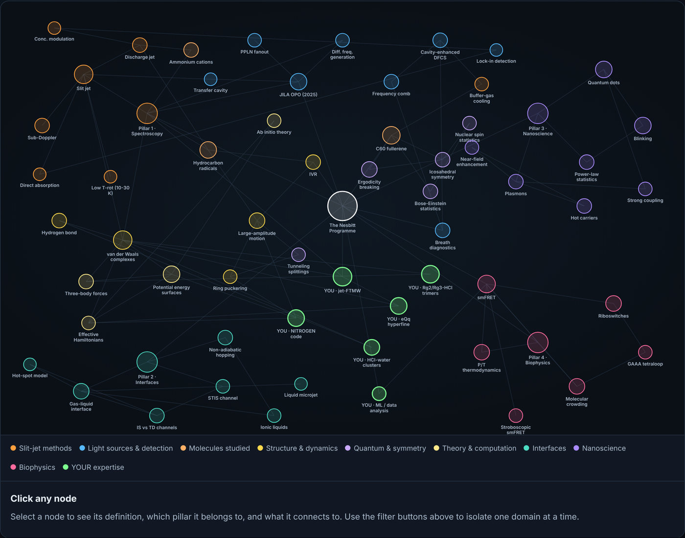
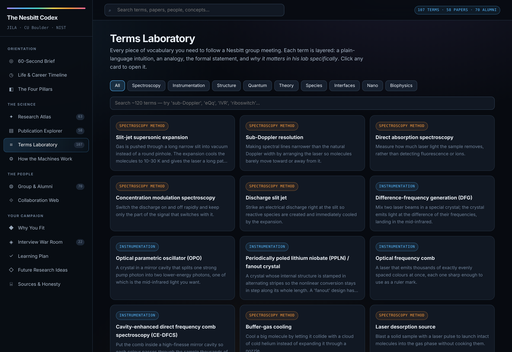

# The Nesbitt Codex

**An interactive research-intelligence platform for the work of Prof. David J. Nesbitt** — Fellow of JILA, NIST physicist, and Professor of Chemistry & Biochemistry *and* Physics at CU Boulder.

A single self-contained HTML page — no framework, no CDN, no build dependencies — that turns four decades of a chemical-physics research programme into something you can actually navigate: a clickable concept atlas, a layered glossary, a filterable publication explorer, and hand-drawn apparatus schematics.

🔗 **[Open the live site →](https://zubayer.github.io/nesbitt/)**



---

## Why this exists

I work on rotational spectroscopy of weakly bound complexes — jet-cooled Fourier-transform microwave, 2–8 GHz. Nesbitt's group works on the same molecules with a completely different instrument: sub-Doppler infrared absorption in slit supersonic jets.

Reading into another group's forty-year output is slow, and the structure of it — which techniques feed which results, which concepts recur, how the four research programmes actually relate — is invisible in a publication list. So I built the thing I wanted to read: a navigable model of the research programme rather than a bibliography of it.

It turned out to be a reasonable demonstration of information architecture too, so it lives here.

---

## What's in it

| Section | Contents |
|---|---|
| **60-Second Brief** | Identity card, citation metrics, the five facts that define the programme |
| **Life & Career Timeline** | Training path, full awards ladder, scientific-lineage diagram |
| **The Four Pillars** | Spectroscopy · Interfaces · Nanoscience · Biophysics — methods, systems, landmark findings, open questions |
| **Research Atlas** | 63-node interactive concept map, 99 edges; click any node to isolate its neighbourhood |
| **Publication Explorer** | 58 curated papers, 1982→2025, filterable and sortable, each with a one-line finding |
| **Terms Laboratory** | 107 terms, each layered *intuition → analogy → formal statement → why it matters in this lab* |
| **How the Machines Work** | Hand-built SVG schematics of the slit-jet IR spectrometer and the smFRET setup |
| **Group & Alumni** | 70-person alumni directory with placement analytics |
| **Collaboration Web** | Key collaborators and what each brings to the programme |
| **Sources & Honesty** | What the platform is built on — and what it could not verify |



---

## Design notes

**One file, zero dependencies.** The published `index.html` is ~300 KB of HTML, CSS, vanilla JS and inline SVG. It renders offline from a `file://` path. No React, no Tailwind, no bundler, nothing fetched at runtime.

**Layered explanation as a first-class pattern.** Every glossary term carries four registers — a plain-language intuition, a concrete analogy, the formal statement, and the specific reason it matters in this research programme. Technical vocabulary usually fails readers at exactly one of those four levels, and which one varies by reader.

**Cross-linking by content, not by hand.** A `linkify()` pass walks rendered prose and turns the first occurrence of each recognised technical phrase into a clickable definition, skipping anything inside an HTML tag and capping at one link per term per block so the text stays readable rather than turning blue.

**Hand-laid graph.** The concept atlas uses fixed coordinates rather than a force-directed layout. Force layouts look organic and read badly — they bury the semantics. Clusters here are positioned to mean something: instrumentation across the top, the four pillars at the corners, symmetry physics near C₆₀.

**Diagrams as code.** The apparatus schematics are hand-written SVG, not images — so they stay sharp, theme with the page, and can be diffed in version control.

---

## Build

```bash
python3 build.py      # concatenates src/ → index.html
```

Sources live in `src/`:

| File | Role |
|---|---|
| `part1_head.html` | Document head and the full stylesheet |
| `part2_body.html` | Page shell and static section markup |
| `data_a.js` | Timeline, awards, pillar definitions, 107-term glossary |
| `data_b.js` | Graph nodes/edges, publications, alumni, collaborators |
| `app.js` | Rendering, filtering, search, graph interaction, SVG generation |

No install step. No `node_modules`. `build.py` only concatenates — there is no transpilation, minification, or templating, so what you read in `src/` is exactly what ships.

---

## Accuracy and limits

Compiled from public sources: the Nesbitt group's own pages, his JILA / CU Chemistry / CU Physics faculty profiles, published papers and their repository records (NIST, OSTI, NSF-PAR, arXiv), and group PhD theses hosted by JILA.

Known limits, also stated in-app:

- The group's live roster page was not rendering its current-members list when this was built. The "recent era" table is **reconstructed from authorship on 2017–2025 papers**, not copied from an official roster.
- Citation metrics come from mirrors of his Google Scholar profile (Scholar blocks automated access) and may lag the live figures.
- The newest confirmed primary papers here are from **2025**. Anything published since is not captured.
- Pillar tags on papers are navigational, assigned by this platform. "Finding" lines are compressed paraphrases written for this project — **not quotations.** Read the originals before citing anything.
- No photographs of any individual are included, by design.

Corrections are welcome — open an issue.

---

## Licence

Code: [MIT](LICENSE).

The compiled research summaries are my own paraphrases and commentary. The underlying scientific work belongs to Prof. Nesbitt, his group members and their collaborators, and is cited throughout so it can be read at the source. This project is independent and is not affiliated with or endorsed by JILA, NIST, or the University of Colorado Boulder.

---

Built by **Sams Zubayer Mridha** ([@zubayer](https://github.com/zubayer)) — rotational spectroscopy of hydrogen-bonded and van der Waals complexes.
